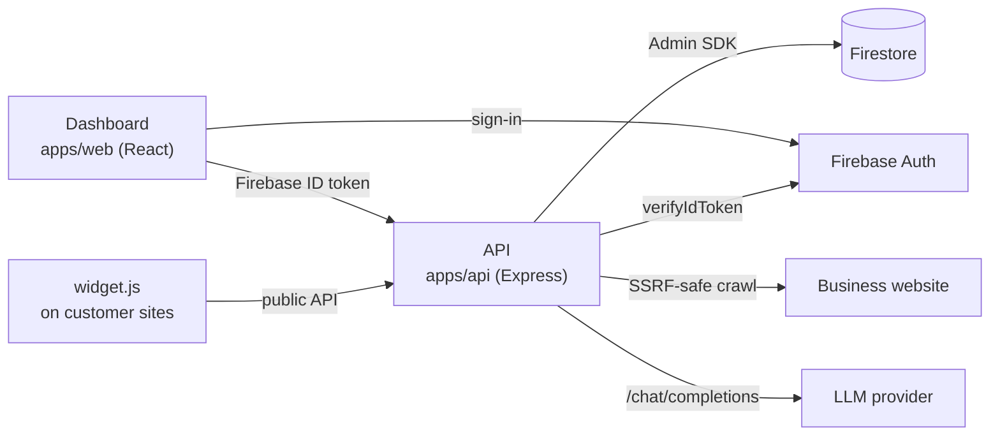

# ChatPilot AI

**Turn any business website into an AI chatbot in minutes.** A business enters its URL. ChatPilot crawls
the site, builds a grounded knowledge base, and gives them a customisable chat widget (one `<script>`
tag) plus a shareable hosted chat page. Conversations land in an inbox, and leads are captured with consent.

## Features

- **Website → knowledge:** an SSRF-safe crawler that respects robots.txt and sitemaps, prioritises key pages and removes boilerplate. Review, exclude or edit sources, and add FAQs or manual content.
- **Grounded answers (RAG):** BM25 retrieval over ≤1,500-char chunks. Answers cite sources and fall back to your message when the knowledge doesn't cover a question.
- **Any LLM:** OpenAI-compatible providers (Gemini, Groq, OpenAI, OpenRouter, Together, Cloudflare Workers AI), Ollama for local use, and a mock provider for development.
- **Preview Studio:** live widget preview in desktop and mobile frames on a mockup of the customer's site. Test chats before publishing.
- **Publish and embed:** versioned publishing. The snippet never changes, and the widget fetches the published config at runtime. A hosted page lives at `/chat/<publicId>`.
- **Widget:** vanilla TS with Shadow DOM, floating on desktop and full-screen on mobile. Brand colour, launcher icon, welcome message, suggested questions and lead form are configurable.
- **Inbox and leads:** conversation transcripts, a leads table and CSV export (plan feature).
- **Plans and quotas:** monthly limits on messages, crawls, pages, leads and knowledge size, with retention per plan. Configurable without code changes.
- **Landing-page live demo:** visitors try it on their own URL. Demo bots expire after 2 hours.
- **Dev mode:** the full stack runs offline, with no Firebase, no AI key and no Java.

## Architecture



All data access goes through the API. The browser uses Firebase only for sign-in, and Firestore rules
deny all client access. See [docs/ARCHITECTURE.md](docs/ARCHITECTURE.md).

## Monorepo

```
apps/api          Express + TypeScript API (also serves /widget.js)      :8787
apps/web          React + Vite + Tailwind dashboard, landing, /chat/:id  :5173
apps/widget       Embeddable widget (esbuild, Shadow DOM) + demo page
packages/shared   Shared contract: types, zod schemas, API routes, plans, embed helpers
firebase/         Firestore/Storage security rules, indexes, rules-test outline
docs/             Architecture, data model, security, deployment, costs, operations…
tests/e2e         Playwright end-to-end tests
render.yaml       Render Blueprint for the API
firebase.json     Firebase CLI config (rules, indexes, optional Hosting)
```

## Quick start: local dev mode in 5 commands

Requirements: Node 22+ and npm. Dev mode uses `AUTH_MODE=dev` (local login, no passwords),
`DATA_STORE=file` (JSON files in `apps/api/.data`) and `AI_PROVIDER=mock` (canned replies).

```bash
npm install
cp apps/api/.env.development.example apps/api/.env.development   # PowerShell: Copy-Item …
npm run build -w @chatpilot/widget      # or `npm run dev:widget` in its own terminal to rebuild on change
npm run dev:api                          # terminal 1 → http://localhost:8787/health
npm run dev:web                          # terminal 2 → http://localhost:5173
```

Open http://localhost:5173 → **Register** with any email → enter a public URL (e.g. `https://example.com`)
→ review → customise → publish → copy the snippet. To try the embed, open `apps/widget/demo/index.html`
with your `data-chatbot-id`.

Optional: `apps/web/.env.development` (`VITE_API_URL`, `VITE_AUTH_MODE=dev`). The defaults already target
`localhost:8787`. For real answers locally, set `AI_PROVIDER=openai` with a key, or use `ollama`. Every
variable is documented in [`.env.example`](.env.example).

## Scripts

| Command | What it does |
|---|---|
| `npm run dev:api` / `dev:web` / `dev:widget` | Dev servers (API watch mode, Vite, widget rebuild-on-change) |
| `npm run build` | Build widget → API → web |
| `npm run lint` | ESLint (flat config, [`eslint.config.js`](eslint.config.js)) in every workspace |
| `npm run typecheck` | `tsc --noEmit` in every workspace |
| `npm test` | Unit and integration tests (vitest) in every workspace |
| `npx playwright test` | E2E journey (starts API + web in dev mode; run `npx playwright install chromium` first) |

## Testing

- **Unit/integration:** `npm test`, which covers the crawler's SSRF guards, quotas, tenant isolation, retrieval and widget rendering.
- **E2E:** [`tests/e2e`](tests/e2e). `main-journey.spec.ts` covers register → crawl → configure → preview → publish → embed → chat → inbox → lead. `widget-responsive.spec.ts` checks the mobile full-screen and desktop floating layouts. Set `E2E_SITE_URL` to crawl a different site. The selector contract is in `tests/e2e/helpers.ts`.
- **Firestore rules:** [`firebase/rules-tests`](firebase/rules-tests). These need the Firestore emulator and **Java 21+**, so they are not part of `npm test`.
- **CI:** [`.github/workflows/ci.yml`](.github/workflows/ci.yml) runs lint, typecheck, test and build on Node 22. E2E runs on manual dispatch.

## Documentation

| Doc | Contents |
|---|---|
| [ARCHITECTURE](docs/ARCHITECTURE.md) | Components, decisions, request flows, scaling path |
| [DATA_MODEL](docs/DATA_MODEL.md) | Firestore collections, indexes, pagination, TTL and retention, document-size strategy |
| [SECURITY](docs/SECURITY.md) | Threat model (SSRF, tenant isolation, prompt injection, XSS, abuse), pre-launch checklist |
| [WIDGET](docs/WIDGET.md) | Embed options, hosted page, CSP, install guides (WordPress, Shopify, Wix, Squarespace, Webflow, GTM, React/Next) |
| [AI_PROVIDERS](docs/AI_PROVIDERS.md) | Provider setup, verified free tiers and terms, cost math, recommendation |
| [DEPLOYMENT](docs/DEPLOYMENT.md) | Step-by-step Firebase + Render + Cloudflare/Firebase Hosting, billing per step, launch checklist |
| [COSTS](docs/COSTS.md) | Free vs paid per component at launch, ~10 and ~100 customers |
| [OPERATIONS](docs/OPERATIONS.md) | Incident runbook, secret rotation, deletion requests, scaling |
| [MONETIZATION](docs/MONETIZATION.md) | Plans and quotas, payment options for India, GST notes |

## Status: what's needed before launch

This is a working product skeleton, not a finished business. Before taking paying customers:

- [ ] **Billing is not integrated.** Plans and quotas are enforced, but upgrades are manual (`users/{uid}.planId`). See [MONETIZATION.md](docs/MONETIZATION.md).
- [ ] **Hosting:** use an always-on API instance. The Render free tier sleeps after 15 minutes and Render says not to use it in production. Don't use Vercel Hobby, which is non-commercial only.
- [ ] **AI provider:** use a paid tier. The Gemini free tier may use prompts for training and is not allowed for EEA/UK users. Set a spend cap.
- [ ] **Crawler limits:** JavaScript-rendered sites (no server HTML) yield little content, so owners must add FAQs or manual text. There is no headless browser yet.
- [ ] **Background work runs in-process:** crawl jobs are lost on restart (marked failed) and rate limits are per instance. Add a queue and a shared store before scaling out.
- [ ] **Retrieval is keyword-based (BM25).** Embeddings would help with synonyms and multilingual questions.
- [ ] **Backups** need Firebase Blaze. TTL also needs Blaze, so demo cleanup relies on the API job on Spark.
- [ ] **Legal:** privacy policy, terms, refund policy, sub-processor list (LLM provider, Firebase, host) and DPDP/GDPR review.
- [ ] Run the E2E suite and the [launch readiness checklist](docs/DEPLOYMENT.md#launch-readiness-checklist) on the production setup.

A successful deploy is not the same as production-ready.
