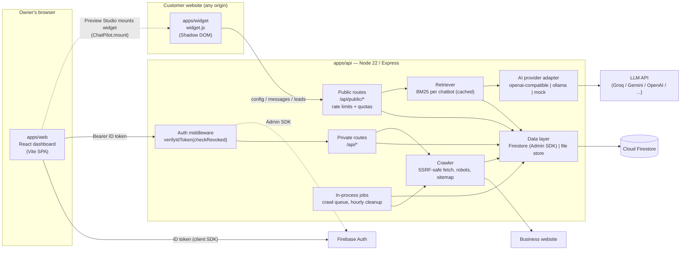

# Architecture

ChatPilot AI turns a business website into a grounded (RAG) chatbot. The owner
signs in, enters a URL, the API crawls the site into text chunks, the owner
configures and publishes the bot, then pastes one `<script>` tag on their site.

## Components



ASCII version:

```
 Owner browser                     Customer site                    External
 ┌──────────────┐  ID token      ┌────────────────┐
 │ apps/web     │──────────────▶ │ Firebase Auth  │
 │ (dashboard)  │                └────────────────┘
 └──────┬───────┘                        ▲ verifyIdToken (Admin SDK)
        │ Bearer token                   │
        ▼                                │
 ┌────────────────────────── apps/api (Express) ───────────────────────────┐
 │ auth ─▶ private routes ─┬─▶ crawler ──(SSRF-safe HTTP)──▶ business site │
 │                         ├─▶ data layer ──(Admin SDK)──▶ Cloud Firestore │
 │ public routes ◀── rate limit / quota / origin check                     │
 │   └─▶ retriever (BM25) ─▶ AI adapter ──(HTTPS)──▶ LLM provider          │
 │ static /widget.js  ·  hourly cleanup job  ·  in-process crawl queue     │
 └──────────────────────────────▲──────────────────────────────────────────┘
                                │ GET config / POST messages, leads
                     ┌──────────┴──────────┐
                     │ widget.js (Shadow   │  on https://customer.example
                     │ DOM) or /chat/:id   │  or the hosted page
                     └─────────────────────┘
```

## Key decisions

| Decision | Choice | Why / trade-off |
|---|---|---|
| Data access | **Only the API** touches Firestore (Admin SDK). Web uses Firebase **only for Auth**. | One place for tenant isolation, quotas and validation. Firestore rules are deny-all (see [SECURITY.md](SECURITY.md)). Cost: no realtime listeners in the dashboard (polling instead). |
| Auth | Firebase Auth (email/password). API verifies ID tokens with `verifyIdToken(token, checkRevoked=true)`; `uid` comes from the token only. | `checkRevoked` costs an extra Auth backend lookup per request but makes "sign out everywhere"/account disable effective immediately. |
| Dev mode | `AUTH_MODE=dev` (local JWT via `POST /api/dev/login`), `DATA_STORE=file` (JSON on disk), `AI_PROVIDER=mock`. | Full stack runs offline with no Firebase project, no Java, no AI key. The API **refuses to start** if `NODE_ENV=production` and any of these is set. |
| AI | Provider adapter: `openai` (any OpenAI-compatible `/chat/completions`), `ollama` (local only), `mock`. | Switch providers with env vars only. Ollama is for local dev — not public production unless you host a GPU server. See [AI_PROVIDERS.md](AI_PROVIDERS.md). |
| Retrieval | BM25 keyword search in-process over the chatbot's chunks, cached per chatbot and invalidated by `knowledgeVersion`. | Zero extra infra/cost, good for small business sites (≤ a few thousand chunks). Interface is replaceable by embeddings + vector DB later. |
| Chunks | Stored as individual docs (≤ 1,500 chars) in `chatbots/{id}/chunks`. | Avoids the 1 MiB Firestore document limit; cheap to rewrite one source. |
| Publishing | Draft config on the chatbot; publish writes an immutable `versions/{n}` doc **and** the `publicConfigs/{publicId}` pointer in one batch. | Atomic publish, instant rollback possible, widget reads one small doc. |
| Widget | Vanilla TS, Shadow DOM, fetches the published config at load. | No CSS conflicts with customer sites; config changes never need a new snippet. |
| Jobs | Crawls run in-process with a concurrency cap; an hourly timer cleans demo bots and expired conversations. | No queue infra. Jobs are **lost on restart** — on boot, `running` jobs are marked `failed` so users can retry. Replace with Cloud Tasks/BullMQ when scaling ([OPERATIONS.md](OPERATIONS.md)). |
| Rate limits | `express-rate-limit`, in-memory. | Per instance only. Use a shared store (Redis/Upstash) once you run >1 instance. |

## Request flows

### Create → crawl → publish

1. `POST /api/chatbots` → chatbot `draft` with default config (plan limit `chatbots` checked).
2. `POST /api/chatbots/:id/crawl` → crawl job `queued` → `running`. The crawler:
   validates the URL (scheme, credentials, port), resolves DNS and rejects private/link-local/metadata
   IPs (IPv4, IPv6, IPv4-mapped), **pins the resolved IP** for the connection, re-validates every redirect,
   enforces byte/time limits, reads `robots.txt` + sitemap, prioritises key pages (home, about, pricing,
   contact, FAQ, services), strips boilerplate (nav/footer/cookie banners), splits into ≤1,500-char chunks.
   JS-only sites yield little text → the job gets a `hint` suggesting manual content/FAQs.
3. The dashboard polls `GET .../crawl-jobs/:jobId`. On completion `knowledgeVersion++` invalidates the retrieval cache.
4. Owner reviews sources (exclude/edit/add FAQ/manual), edits config, tests in Preview Studio
   (`POST .../preview/messages`, not stored, counts toward usage).
5. `POST .../publish` → batch: `chatbots/{id}/versions/{n}` + `publicConfigs/{publicId}` + chatbot
   `{status:'published', publishedVersion:n, hasUnpublishedChanges:false}`. Returns embed code + hosted URL.

### Visitor chat

1. `widget.js` reads `data-chatbot-id`/`data-api-url`, `GET /api/public/chatbots/:publicId/config`.
2. Visitor sends a message → `POST .../messages` with a random `visitorId`.
   API checks: rate limit (IP + chatbot), Origin vs `allowedOrigins` (soft), message length,
   owner's monthly `messagesPerMonth` quota, `conversationToken` (HMAC) to append to an existing conversation.
3. Retriever picks top chunks → prompt (system rules + business config + context + short history) → LLM.
   No grounded answer / provider failure → configured `fallbackMessage` (`fallback: true`).
4. Conversation + messages stored; usage incremented; reply returned with source links.
5. Lead form (per `leadCapture.trigger`) → `POST .../leads` → `leads/{id}` (consent required).

## Monorepo layout

```
apps/api       Express API (TypeScript, tsup build, vitest)
apps/web       React + Vite + Tailwind dashboard, landing page, hosted chat page /chat/:publicId
apps/widget    widget.js (esbuild, vanilla TS, Shadow DOM) + demo/index.html
packages/shared  Contract: types, zod schemas, routes (api.ts), plans, embed helpers
firebase/      Firestore & Storage rules, indexes, rules-test outline
docs/          This documentation
tests/e2e      Playwright end-to-end tests
```

## Scaling path (when needed)

| Pressure | Change |
|---|---|
| > 1 API instance | Shared rate-limit store (Redis/Upstash), move crawl jobs to a queue (Cloud Tasks / BullMQ), move the hourly cleanup to Cloud Scheduler or one designated instance. |
| Large knowledge bases / multilingual queries | Embeddings + vector index (Firestore vector search, pgvector, or a hosted vector DB) behind the retriever interface; keep BM25 for hybrid ranking. |
| JS-heavy sites | Headless-browser rendering worker (separate service, strict SSRF controls). |
| Cold starts | Paid always-on instance (see [DEPLOYMENT.md](DEPLOYMENT.md)). |
